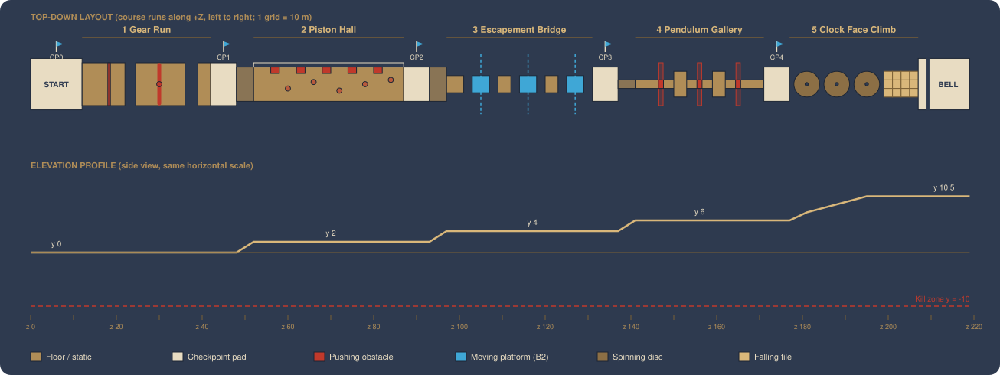

# Clockwork Tempo: Level Design

The course is a climb through a clock tower: start in the winding room at the base, finish at the bell at the top. It runs along **+Z**, rises from **y 0 to y 10.5**, and is about **219 m** long. Five obstacle sections get harder in order. Every section ends on a safe checkpoint pad.

## Design rules (from PROGRESS.md design metrics)

| Rule | Value | Source |
|---|---|---|
| Highest ledge to jump onto | 1.8 m | Full jump 2.2 m |
| Low barrier to hop | 0.8 m | Tap jump about 1.1 m |
| Standard gap | 2 to 3.5 m | Jump distance about 6.1 m at top speed |
| Widest gap | 4.5 m | Leaves room for a late or slow jump |
| Narrowest walkway | 2 m | Stopping distance about 0.5 m, capsule 1 m wide |
| Main path width | 8 to 10 m | Room to dodge |
| Shortest safe timing window | 2 beats (1 s at 120 BPM) | Jump airtime about 0.76 s |
| Ramp angle | 30 degrees or less | Max walkable slope 45 degrees |
| Moving platform peak speed | 4 m/s or less | Rideable without being thrown |

## Rhythm (the twist)

Every moving obstacle is timed in **beats**, and 4 beats make a **bar**. The Conductor (Phase 5) publishes the beat from the music. Target tempo is **120 BPM** (beat 0.5 s, bar 2 s), and the final value is chosen with the music track. Without a Conductor, obstacles run the same patterns on local time.

## Sections

| # | Name | Z range | Height (y) | Size (W x L) | Obstacles (Phase 5 component) | Tests | Difficulty |
|---|---|---|---|---|---|---|---|
| Start | Winding Room | 0 to 12 | 0 | 12 x 12 | None | Spawn, countdown | 0 |
| 1 | Gear Run | 12 to 42 | 0 | 10 x 30 | Low barrier, two gaps, one sweeper bar (Rotator) | Running, jumping, first timing | 1 |
| 2 | Piston Hall | 52 to 87 | 2 | 8 x 35 | 5 wall pistons (Pusher), 5 bumper pegs (Bumper), open right edge | Reaction, being pushed off | 2 |
| 3 | Escapement Bridge | 97 to 131 | 4 | 4 x 34 | 3 horizontal moving platforms (MovingPlatform), 2 fixed islands | Riding platforms (B2), timing jumps | 3 |
| 4 | Pendulum Gallery | 141 to 171 | 6 | 2 x 30 beam | 3 swinging hammers (Oscillator, rotation), 2 rest pads | Precision on a narrow beam, timing | 4 |
| 5 | Clock Face Climb | 177 to 207 | 7.5 to 10.5 | 3 discs, 3 x 4 tile grid | 3 spinning disc platforms (Rotator), falling tiles (FallingTile) | Combined: rotating footing, climbing, keeping moving | 5 |
| Finish | Bell Tower | 207 to 219 | 10.5 | 12 x 12 | Finish line trigger at z 209 | End Point | 0 |

Connecting ramps (4 m long, 2 m rise, about 27 degrees) sit at z 48 to 52, 93 to 97 and 137 to 141, all right after a checkpoint pad.

## Section build specs

Positions are world space. The course centre line is x = 0, and floors are given by their top surface height.

### Start: Winding Room
- Platform: x -6 to 6, z 0 to 12, top y 0.
- **Start Point** (spawn) at (0, 0, 4), facing +Z.

### 1 Gear Run (z 12 to 42, y 0)
- Floor pieces: z 12 to 22, z 24.5 to 36, z 39 to 42, each x -5 to 5.
- Low barrier: z 18 to 18.6, height 0.8, full width. Static and hoppable.
- Gaps: z 22 to 24.5 (2.5 m) and z 36 to 39 (3 m).
- Sweeper: pivot at (0, 0, 30), bar 9 m long, 0.6 m thick, centred at y 0.5. One revolution every **4 bars**. Jump it or time your crossing.

### Checkpoint 1 pad: z 42 to 48, x -5 to 5, y 0. Ramp z 48 to 52 up to y 2.

### 2 Piston Hall (z 52 to 87, y 2)
- Floor: x -4 to 4. Left wall at x -5 to -4, 4 m tall. **Right edge open** with no railing.
- Pistons in the left wall at z 57, 63, 69, 75, 81. Each head is 2 x 2 m and pushes 1.5 m toward +X.
- Pattern: odd pistons (1, 3, 5) fire on beat 1 and even pistons (2, 4) on beat 3, once per bar, so the hall alternates in a readable rhythm. Each extends in half a beat, holds for 1 beat and retracts over 1.5 beats.
- Bumper pegs (radius 0.6, height 1.2) at (1, 60), (-0.5, 66), (1.5, 72), (0, 78), (-1, 84). Each knocks the player back with an impulse.

### Checkpoint 2 pad: z 87 to 93, x -4 to 4, y 2. Ramp z 93 to 97 up to y 4.

### 3 Escapement Bridge (z 97 to 131, y 4)
- Fixed islands 4 m wide (x -2 to 2): z 97 to 101, z 109 to 112, z 120 to 123.
- Moving platforms, 4 x 4 m, travelling along X between x -5 and x 5 with sine easing. Each one-way trip takes **2 bars** (4 s at 120 BPM, peak speed about 3.9 m/s):
  - MP1 at z 103 to 107
  - MP2 at z 114 to 118, half a cycle out of phase with MP1
  - MP3 at z 125 to 129, in phase with MP1
- Every jump between an island and a platform crosses a 2 m gap, and only lines up while the platform passes x = 0.

### Checkpoint 3 pad: z 131 to 137, x -4 to 4, y 4. Ramp z 137 to 141 (2 m wide) up to y 6.

### 4 Pendulum Gallery (z 141 to 171, y 6)
- Beam: x -1 to 1, z 141 to 171, built as three pieces (z 141 to 150, 153 to 159, 162 to 171) so it never overlaps the rest pads.
- Rest pads (6 m wide): z 150 to 153 and z 159 to 162.
- Hammers at z 147, 156 and 165. Pivots sit at y 13, with 5.7 m from pivot to head centre, so the bottom of each 2 x 2 x 1 m head clears the beam by 0.3 m. Heads swing across X through ±60 degrees. A full swing takes **2 bars** (8 beats), and neighbouring hammers are a quarter cycle apart. Each head crosses the beam every 4 beats, leaving about 3 beats (1.5 s) to get past it.

### Checkpoint 4 pad: z 171 to 177, x -4 to 4, y 6.

### 5 Clock Face Climb (z 177 to 207)
- Spinning discs (radius 3, 0.5 m thick) rotate about Y and the player rides them. Heights below are the disc tops:
  - disc 1 at (0, 7.5, 181), 1 revolution per 4 bars
  - disc 2 at (0, 9, 188), 1 revolution per 3 bars, reversed
  - disc 3 at (0, 10.5, 195), 1 revolution per 2 bars
- Each disc is 1.5 m higher than the last, with a 1 m edge gap between discs.
- Falling tiles: a 3 x 4 grid of 2 x 2 m tiles at y 10.5, covering x -3 to 3 and z 199 to 207. A tile drops 0.5 s after the player touches it and respawns after 3 s.

### Finish: Bell Tower
- Platform: x -6 to 6, z 207 to 219, top y 10.5.
- **End Point**: a finish line trigger across the full width at z 209 to 209.6, 4 m tall. A greybox arch (posts at x ±5.5, beam at y 16) marks it. The bell prop is placed in Phase 6.

## Checkpoints

| Index | Name | Respawn position | Facing |
|---|---|---|---|
| 0 | Start Point | (0, 0, 4) | +Z |
| 1 | After Gear Run | (0, 0, 45) | +Z |
| 2 | After Piston Hall | (0, 2, 90) | +Z |
| 3 | After Escapement Bridge | (0, 4, 134) | +Z |
| 4 | After Pendulum Gallery | (0, 6, 174) | +Z |

- Each checkpoint is a trigger covering its whole pad, so you can't run past it without activating it. Checkpoints only ever advance (see PROGRESS.md).
- No obstacle can reach a checkpoint pad.

## How the greybox is built
- `Tools > Clockwork Tempo > Build Greybox` (Assets/_Project/Scripts/Editor/GreyboxBuilder.cs) creates every static floor, pad, island, beam, the finish platform and arch, and static placeholders for the moving platforms, discs and falling tiles, all as ProBuilder meshes named `GB_*`. It also places the hand built `Ramp_8w` and `Ramp_2w` prefabs.
- Built by hand in ProBuilder: `Start_Platform`, both ramp prefabs (edge editing) and the Piston Hall wall (extrude).
- Running the tool again replaces only `GB_*` objects. Phase 5 replaces the placeholders with scripted obstacles.

## Kill zone
- One trigger box under the whole course: centre (0, -10, 110), size (80, 2, 260).
- Falling from the top section (y 10.5) reaches it in about 1 s, so respawns stay quick.

## Requirement coverage

| Spec item | Where |
|---|---|
| Starting Point | Winding Room spawn, checkpoint 0 |
| End Point | Bell Tower finish line |
| ProBuilder course | All floors, walls, ramps and pads (Phase 2.3) |
| Checkpoints and respawn | 5 checkpoints and the kill zone |
| Obstacles that push the player off | Sweeper, pistons, bumpers, hammers |
| Variety (6 or more types) | Sweeper, piston, bumper, moving platform, pendulum, spinning disc, falling tile (7) |
| B2 horizontal moving platforms | Escapement Bridge MP1 to MP3 |

## Expected run times (placeholders, set in Phase 4 after playtesting)
- Pure running distance is about 219 m, roughly 27 s at top speed.
- With obstacle waits, expect about 70 to 100 s for a clean run.
- Draft remark thresholds: Gold under 75 s, Silver under 100 s, Bronze under 140 s, otherwise "Keep practicing".
