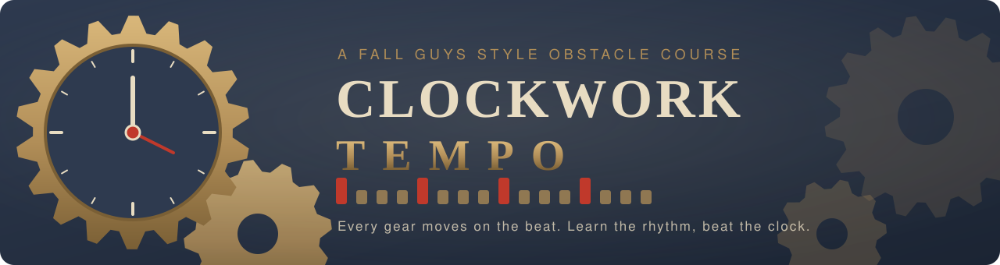
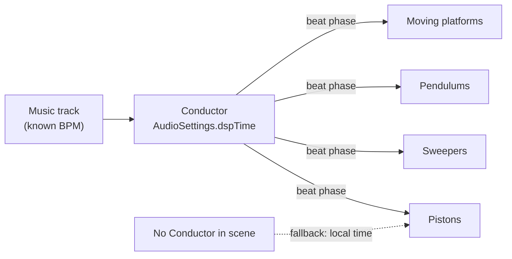
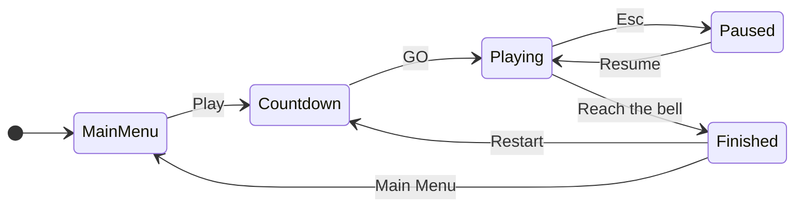

<div align="center">



<br/>


**A single player, physics driven obstacle course inside a giant clock tower.**<br/>
Every gear, piston and pendulum moves on one shared musical beat.

[About](#about) · [The Twist](#the-twist-the-conductor) · [Controls](#controls) · [Features](#features) · [Getting Started](#getting-started) · [Roadmap](#roadmap) · [Architecture](#architecture)

</div>

---

## About

**Clockwork Tempo** is a Fall Guys style race built in Unity 6 for **VGP233 Programming for Game Engines** (Assignment 3, LaSalle College Vancouver). You guide a wobbly bean from the base of a brass clock tower to the bell at the top. Along the way, the tower's machinery shoves, sweeps and knocks you off the course while a run timer records your time.

<table>
<tr>
<td width="50%" valign="top">

### The Goal
Reach the bell at the top of the tower as fast as you can. Fall and you respawn at your last checkpoint while the clock keeps running.

</td>
<td width="50%" valign="top">

### The Feel
Momentum based Rigidbody movement, coyote time, jump buffering and a mouse orbit camera. Obstacles push you with real physics, not scripted teleports.

</td>
</tr>
</table>

---

## The Twist: The Conductor

> **The whole tower keeps time.**

A single **Conductor** reads the music's playback clock and publishes the current beat. Every moving obstacle reads its phase from that beat instead of from its own timer. The result:

| Without the Conductor | With the Conductor |
|:--|:--|
| Each obstacle has its own unrelated timing | Every obstacle moves on the same beat |
| Players memorize obstacle by obstacle | Players learn one rhythm and read the whole course |
| Audio is decoration | Audio becomes a gameplay cue |



> [!NOTE]
> The Conductor is optional by design. If it is missing, every obstacle falls back to local time, so core gameplay never depends on audio sync.

---

## Controls

<div align="center">

| Action | Input |
|:--|:--:|
| Move | <kbd>W</kbd> <kbd>A</kbd> <kbd>S</kbd> <kbd>D</kbd> |
| Camera orbit | <kbd>Mouse</kbd> |
| Jump | <kbd>Space</kbd> |
| Pause | <kbd>Esc</kbd> |

</div>

---

## Features

> [!IMPORTANT]
> This is the target feature set for the final build. See the [Roadmap](#roadmap) for what is finished.

| Feature | Details |
|:--|:--|
| **Run timer** | Starts after the 3, 2, 1, GO countdown, stops at the finish, shows your final time as `mm:ss.ff` |
| **Speed remarks** | Gold, Silver, Bronze or "Keep practicing", with a saved personal best |
| **Checkpoints** | Ordered and forward only. Falling returns you to your latest one |
| **Physics obstacles** | Kinematic Rigidbodies moved in `FixedUpdate`, so pushes are consistent |
| **Rideable platforms** | Horizontal movers that carry the player without sliding or jitter |
| **Third person camera** | Cinemachine 3 orbit with collision so it never clips through walls |
| **Fixed 1920x1080** | Windowed, non resizable, every canvas scaled from a 1920x1080 reference |

### Palette


---

## Getting Started

### Requirements
- **Unity 6000.3.26f1** (Unity 6.3 LTS) with Windows Build Support
- **Git** with **Git LFS** (textures, models, audio and fonts are stored in LFS)

### Clone and open

```bash
git lfs install
git clone https://github.com/<your-user>/ClockworkTempo.git
```

1. Open **Unity Hub**, click **Add > Add project from disk** and select the `ClockworkTempo` folder.
2. Open with editor **6000.3.26f1**.
3. Open `Assets/_Project/Scenes/Course.unity` and press **Play**.

> [!TIP]
> Set the Game view to **1920x1080** before you check the UI. That is the only resolution the game is built for.

---

## Roadmap

- [ ] **Phase 0** · Project foundation (URP, packages, Git, folder layout)
- [ ] **Phase 1** · Player controller and third person camera
- [ ] **Phase 2** · ProBuilder level greybox
- [ ] **Phase 3** · Game flow, checkpoints and respawn
- [ ] **Phase 4** · Timer, HUD, menus and finish screen
- [ ] **Phase 5** · Obstacles, the Conductor and moving platforms
- [ ] **Phase 6** · Art, lighting, audio and juice
- [ ] **Phase 7** · QA, build and submission

Detailed progress, decisions and tuning values live in [`PROGRESS.md`](PROGRESS.md).

---

## Architecture



- **GameManager** owns the state machine above and raises C# events (`OnCheckpointReached`, `OnPlayerRespawned`, `OnRaceFinished`).
- Systems subscribe to events in `OnEnable` and unsubscribe in `OnDisable` instead of holding direct references to each other.
- Small single purpose components (`Rotator`, `Oscillator`, `Pusher`, `Bumper`, `MovingPlatform`, `Checkpoint`, `KillZone`) are combined to build each obstacle.
- Input is read in `Update`, physics runs in `FixedUpdate`, and Cinemachine handles the camera.

<details>
<summary><b>Project structure</b></summary>

```text
Assets/_Project/
├── Art/            Models, Textures
├── Audio/          Music, SFX
├── Materials/
├── Prefabs/
├── Scenes/         Course.unity
├── ScriptableObjects/
├── Scripts/
│   ├── Core/       GameManager, boot and game flow
│   ├── Player/     Controller and visuals
│   ├── Obstacles/  Reusable obstacle components
│   ├── Level/      Checkpoints, kill zone, finish
│   ├── Rhythm/     Conductor
│   └── UI/         HUD, menus, finish screen
├── Settings/       Input actions
├── ThirdParty/
└── UI/             Fonts, Sprites
```

</details>

<details>
<summary><b>Coding standards</b></summary>

- One namespace for the whole project: `ClockworkTempo`
- `[SerializeField] private` fields named `_camelCase`, and read only properties for outside access
- Component references cached in `Awake`, never looked up in `Update`, `FixedUpdate` or collision callbacks
- `CompareTag` and LayerMasks for physics queries
- Tuning values in serialized fields or ScriptableObjects, no magic numbers
- No allocations in hot paths, no stray `Debug.Log`

</details>

---

## Credits

| Role | Name |
|:--|:--|
| Design and programming | **Vishesh Mistry** · [vishhz.dev](https://vishhz.dev) |
| Course | VGP233 Programming for Game Engines, LaSalle College Vancouver |
| Third party assets | Listed in `CREDITS.md` as they are added |

<div align="center">
<br/>
<sub>Built with Unity 6 · Academic project, not for commercial distribution</sub>
</div>